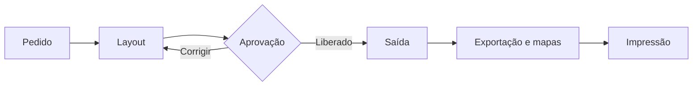

# Manual StopBall

**Manual integrado do setor de arte da StopBall Uniformes** — do pedido à impressão, com documentação versionada por processo.

> **Situação atual:** `0.4.0-draft`, em revisão. O conteúdo reúne regras textuais recebidas e documentos anteriores, mas ainda não representa homologação formal nem auditoria exaustiva de todo o histórico. Não aplicar valores incertos sem confirmação.

## Comece aqui

**[Abrir Manual Geral](docs/MANUAL-GERAL.md)** — visão geral, fluxo, critérios de liberação e acesso a todos os procedimentos.

### Procedimentos

| Etapa | Documento |
|---|---|
| Pedido, layout e aprovação | [01-PEDIDO-LAYOUT.md](docs/01-PEDIDO-LAYOUT.md) |
| Saída de artes | [02-SAIDA-DE-ARTES.md](docs/02-SAIDA-DE-ARTES.md) |
| Exportação e impressão | [03-EXPORTACAO-IMPRESSAO.md](docs/03-EXPORTACAO-IMPRESSAO.md) |
| Qualidade e correção de erros | [04-QUALIDADE-ERROS.md](docs/04-QUALIDADE-ERROS.md) |
| Modelagens e medidas | [05-MODELAGENS-MEDIDAS.md](docs/05-MODELAGENS-MEDIDAS.md) |
| Linhas, tecidos e gabaritos | [06-LINHAS-GABARITOS.md](docs/06-LINHAS-GABARITOS.md) |
| Escudos, personalizações e SISBolt | [07-ESCUDOS-SISBOLT.md](docs/07-ESCUDOS-SISBOLT.md) |

### Controle, fontes e materiais visuais

- [Checklists integrados](checklists/CHECKLISTS.md)
- [Catálogo de gabaritos, mapas e imagens](referencias/IMAGENS-E-GABARITOS.md)
- [Rastreabilidade das regras](governanca/RASTREABILIDADE.md)
- [Pendências de homologação](governanca/PENDENCIAS.md)
- [Fontes e limitações da consolidação](governanca/FONTES.md)
- [Histórico de alterações](CHANGELOG.md)

## Fluxo resumido

**Regra principal:** qualquer pedido sinalizado com erro deve ser bloqueado na etapa afetada, corrigido na origem e **revisado integralmente** antes de nova liberação. Os checklists por etapa são aplicáveis conforme produto/serviço.

## Como revisar e manter

1. Selecionar o capítulo correspondente ao assunto.
2. Conferir o texto com pedido, fonte original e regra fornecida.
3. Identificar **regra confirmada, exceção, informação histórica ou pendência**.
4. Alterar procedimento, checklist, rastreabilidade e `CHANGELOG.md` quando necessário.
5. Preparar **PNG real** a partir de contorno aprovado, quando houver ilustração específica; não substituir por desenho genérico.
6. Revisar alterações em pull request antes de considerar a próxima versão consolidada.

Os PDFs de gabaritos e fluxos gerados anteriormente estão catalogados. A publicação dos binários no GitHub público depende de checagem de uso e privacidade. Conversas de WhatsApp, dados pessoais e arquivos de clientes **não devem ser publicados em bruto**.

### Identificadores documentais

- `MAN-DES-001`: Manual Geral
- `POP-DES-*`: procedimentos operacionais
- `CHK-DES-GERAL-001`: checklists integrados
- `REQ-*`: itens de rastreabilidade

A numeração dos documentos não deve ser confundida com o número de versão: o procedimento 001 pode evoluir de versão sem trocar seu código.

## Complementação baseada nas fontes — edição 0.5

- [Controle entre Vendas, Layout e Saída](docs/08-INTERFACE-VENDAS-LAYOUT.md)
- [Qualidade do Layout antes da Saída](docs/09-CONTROLE-QUALIDADE-LAYOUT.md)
- [Devoluções entre Exportação e Impressão](docs/10-DEVOLUCOES-EXPORTACAO-IMPRESSAO.md)
- [Auditoria das reuniões e históricos de ocorrências](governanca/AUDITORIA-FONTES-V0.5.md)

Esses capítulos preservam **evidências e exceções com sua origem**. Não equivalem à auditoria completa de todas as notas, mídias ou páginas manuscritas.

### Revisão de manuscritos — v0.6-draft

- [Controle de status, versões e liberação entre setores](docs/11-CONTROLE-STATUS-VERSOES-PEDIDOS.md)
- [Auditoria complementar de reuniões e anotações manuscritas](governanca/AUDITORIA-MANUSCRITOS-V0.6.md)

Esta rodada conferiu visualmente as **8 páginas** da reunião de arte-finalistas, as **5 páginas** da reunião de vendedores, as páginas **17–23 de Notes 2** e as **11 páginas** de anotações de maio de 2024. Os demais manuscritos continuam em revisão; não foram classificados como concluídos.

### Checklist integrado: 141 verificações — versão 0.7-draft

A comparação direta dos DOCX confirmou que os **98 itens do checklist legado v1.4 foram preservados** no integrado v0.2, que possui **141 itens**, não 140.

- [Parte 1 — Pedido, Layout e Grid (57)](checklists/INTEGRADO-141-PARTE-1.md)
- [Parte 2 — Patrocinadores, Escudos, SISBolt e pós-processamento (48)](checklists/INTEGRADO-141-PARTE-2.md)
- [Parte 3 — Liberação, Exportação e Impressão (36)](checklists/INTEGRADO-141-PARTE-3.md)
- [Auditoria de preservação dos códigos e textos](governanca/AUDITORIA-CHECKLIST-141-V0.7.md)

Esses arquivos são transcrições de verificações, **não comprovam auditoria integral dos históricos** nem homologação dos valores pendentes.

### Revisão documental 0.8 — grids e notas históricas

- [POP 012 — Conferência de camadas, grids e nomes de moldes](docs/12-CAMADAS-GRIDS-MOLDES.md)
- [AUD-008 — Auditoria visual do Notes 2 (30 páginas)](governanca/AUDITORIA-NOTES2-V0.8.md)

A inspeção de **Notes 2** cobre as 30 páginas em duas rodadas (0.6 e 0.8). Não significa que todas as anotações manuscritas de outros PDFs estejam integralmente transcritas, nem que códigos antigos estejam homologados.

### Revisão 0.9 — notas curtas e qualidade pré-impressão

- [Auditoria de cinco PDFs curtos e versões de conversas](governanca/AUDITORIA-FONTES-V0.9.md)
- [POP 013 — Qualidade visual antes e após impressão](docs/13-QUALIDADE-VISUAL-PRE-IMPRESSAO.md)

Foram revistas oito páginas de notas curtas e documentadas diferenças reais de cobertura entre os ZIPs compactos do GitHub e exportações maiores disponibilizadas anteriormente. O repositório ainda **não contém todas as versões grandes** das conversas.
