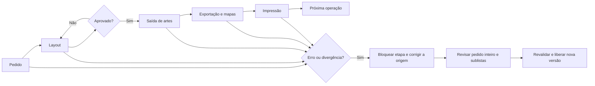

# Manual StopBall

Documentação versionada dos processos do setor de arte da **StopBall Uniformes**, do recebimento do pedido à impressão.

> **Status: versão de trabalho — não homologada.** Este repositório consolida orientações fornecidas, documentos anteriores e ocorrências operacionais. Em caso de dúvida ou divergência, interrompa a etapa afetada e obtenha confirmação no pedido vigente. Não use um exemplo histórico como substituto da aprovação atual.

## Navegação

- [Manual geral](docs/MANUAL-GERAL.md): visão completa, responsabilidades e critérios de transferência.
- [Recebimento e layout](docs/01-PEDIDO-LAYOUT.md): entrada, criação, aprovação e versionamento.
- [Saída de artes](docs/02-SAIDA-DE-ARTES.md): moldes, montagem, escudos, SISBolt e Atalhos.
- [Exportação e impressão](docs/03-EXPORTACAO-IMPRESSAO.md): materiais, gabaritos, mapas, impressão e rastreamento.
- [Qualidade e erros](docs/04-QUALIDADE-ERROS.md): revisão integral após sinalização e prevenção de retrabalho.
- [Checklists por etapa](checklists/CHECKLISTS.md): verificações obrigatórias e condicionais.
- [Gabaritos e imagens pendentes](referencias/IMAGENS-E-GABARITOS.md): especificações para ilustrar sem inventar desenhos.
- [Pendências de validação](governanca/PENDENCIAS.md): dúvidas e divergências a homologar.
- [Fontes e rastreabilidade](governanca/FONTES.md): inventário e limites da consolidação.
- [Histórico de alterações](CHANGELOG.md).

## Fluxo de trabalho

O fluxo é conceitual. Os responsáveis e aprovadores formais ainda precisam ser homologados.

## Classificação de informações

- **REGRA CONFIRMADA:** instrução fornecida expressamente para aplicação operacional.
- **EXCEÇÃO:** condição de modelagem ou pedido que altera o padrão.
- **REFERÊNCIA HISTÓRICA:** anotação, exemplo ou ocorrência, sem alcance universal confirmado.
- **PENDENTE:** aspecto que precisa de definição antes de se tornar regra obrigatória.
- **PROPOSTA:** sugestão de controle, organização ou automação, ainda não homologada.

## Como manter atualizado

1. Criar uma branch `docs/<assunto>`.
2. Atualizar o documento específico, mantendo termos técnicos utilizados pela StopBall.
3. Anotar a origem e os impactos nos checklists.
4. Registrar mudanças no `CHANGELOG.md`.
5. Revisar em pull request antes de consolidar na branch principal.

**Privacidade:** não publicar conversas brutas de WhatsApp, nomes de clientes, telefones ou dados pessoais no repositório público. Use ocorrências anonimizadas e arquivos autorizados para compartilhamento.

**Importante:** a versão em Markdown não substitui automaticamente os PDFs originais; arquivos binários técnicos e imagens devem ser incorporados separadamente, após verificação de direitos de acesso e autorização.
