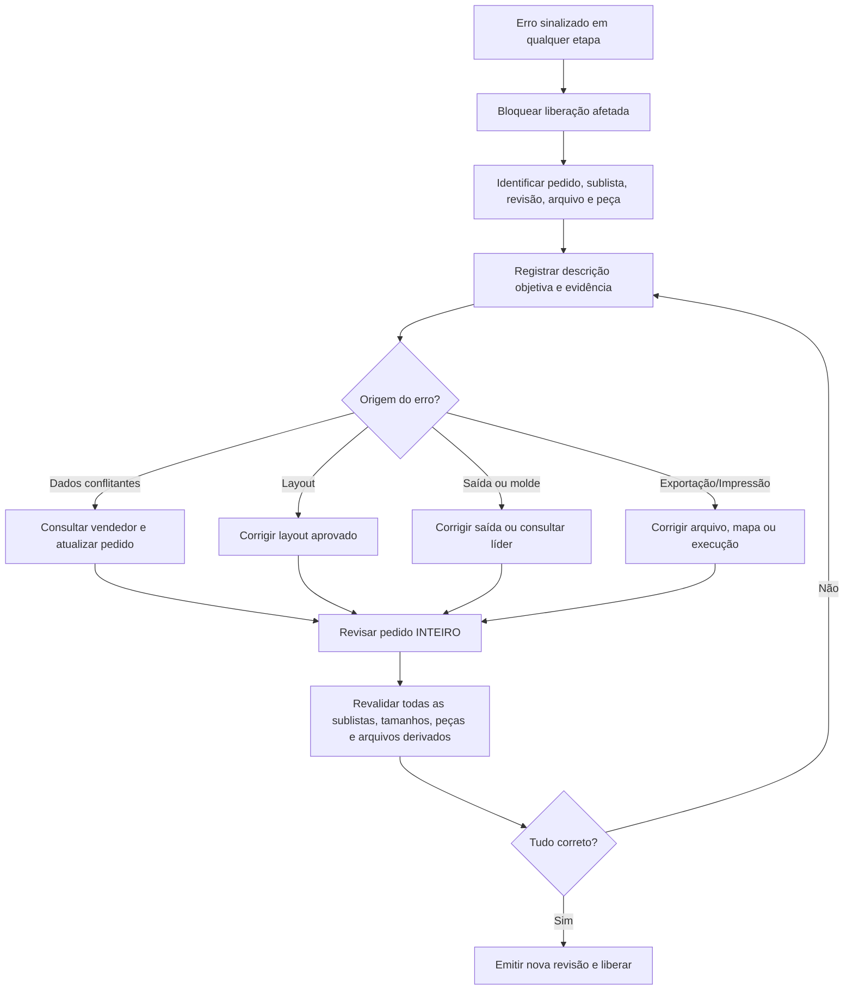

# Procedimento — Qualidade, Erros e Devoluções

**Estado:** versão de trabalho. A regra central foi fornecida expressamente: **qualquer pedido sinalizado com erro deve ser revisado e corrigido por inteiro**.

## Fluxo de tratamento de ocorrência

## Regras obrigatórias

1. Não corrigir somente o elemento citado no apontamento.
2. Rever todas as peças e variantes do pedido: frente, costas, mangas, shorts/bermudas, capuz, gola, punho, escudos, logos, patrocinadores e personalizações aplicáveis.
3. Conferir todas as sublistas, tamanhos e o **arquivo que seguirá efetivamente para produção**.
4. Reaplicar as verificações pertinentes do checklist, incluindo as que já tinham sido aprovadas.
5. Registrar a nova versão e impedir o uso acidental de arquivos e evidências desatualizados.
6. A origem do erro deve ser corrigida; se a informação veio errada do pedido, consultar o vendedor e atualizar o registro.
7. Uma dúvida legítima sobre o pedido não deve ser contabilizada automaticamente como erro do operador.

## Tipos de falha encontrados nos históricos

- Patrocinador ou escudo incorreto, inclusive versões de cores diferentes.
- Nome, número ou personalização ausentes, trocados ou com grafia incorreta.
- Aprovado em prévia, mas grid/arquivo de produção não atualizado.
- Seleção de layout antigo parecido.
- Peças, mangas, shorts, capuz ou componentes esquecidos.
- Posicionamento e espelhamento incompatíveis com a peça.
- Logos de baixa resolução, alterações de cor que distorcem arte, falta de excedente.
- Correção em uma única sublista, mantendo erro em outras.

## Indicadores e justiça na avaliação

Priorizar dados de pedidos tratados, peças e complexidade, além das ocorrências detectadas. **Contagem absoluta de erros sem volume produzido não representa taxa individual confiável.** Anonimizar exemplos em materiais públicos. Usar dados de ocorrência para melhorar barreiras e treinamento, não apenas atribuir culpa.

## Rastreabilidade mínima sugerida

| Campo | Uso |
|---|---|
| Pedido / sublista | Relacionar todas as peças afetadas |
| Etapa / arquivo / versão | Identificar a origem |
| Descrição e evidência | Explicar objetivamente o problema |
| Decisão e responsável | Registrar a correção autorizada |
| Nova revisão | Evitar uso de arquivo antigo |
| Revalidação integral | Provar que o pedido inteiro foi reconferido |

## Ferramentas e histórico

Os grupos “Saídas de Emergência” e “Ajustar pedidos” são fontes de exemplos e investigação, não substitutos da informação oficial do pedido. Não publicar exportações brutas em repositório público.
