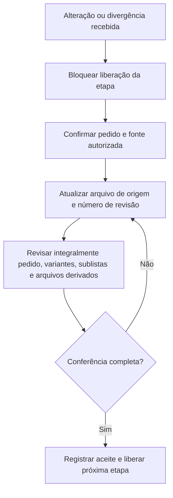

# POP-DES-011 — Estado do pedido, revisões e liberação entre setores

**Versão:** 0.6-draft · **Natureza:** procedimento preventivo derivado de registros de problemas e regras de revisão integral.  
**Fontes:** [Notes 2, páginas 18–22](../fontes/extraidos/anotacoes/Notes/Notes%202.pdf) e [AUD-006](../governanca/AUDITORIA-MANUSCRITOS-V0.6.md). Itens marcados como *proposta de controle* não são funcionalidades comprovadamente existentes no sistema.

## 1. Por que existe este procedimento

As anotações documentam pedidos cadastrados no setor errado, pedidos cancelados que continuam aparecendo, divergência entre previsão impressa e data exibida no sistema, alteração tardia do pedido e revisão parcial do layout.

Não basta ver um arquivo ou uma linha na fila para concluir que o pedido está **ativo, aprovado e pronto para produzir**.

## 2. Regras para começar qualquer etapa

1. Identificar pedido, cliente, sublista, produto e variante.
2. Consultar o **estado atual** no sistema/pedido vigente e identificar se foi cancelado, alterado ou transferido de setor.
3. Confirmar **qual é a última versão aprovada**; última saída, arquivo de Atalhos ou impressão anterior são somente referências.
4. Comparar data de entrega e prioridade presentes no pedido com a informação operacional. Se houver divergência, consultar a origem em vez de escolher uma das datas por suposição.
5. Registrar qual decisão resolve a divergência; não fazer montagem de produção com pedido cancelado ou autorização incerta.

## 3. Quando há alterações de última hora

A ocorrência deve conter **o que mudou, em que peças/variantes/sublistas, quem autorizou e qual arquivo foi refeito**. Uma revisão parcial não significa pedido integralmente corrigido.

**Fluxo proposto:**

## 4. Critérios específicos por setor

### Layout
- Não transferir arte com várias mudanças solicitadas quando somente uma estiver refletida no arquivo.
- Identificar versão, aplicações por lado e por variante, e a **gola/modelo** quando houver variações.
- Verificar que a referência de escudo/logos e fontes é a aprovada.

### Saída
- Confirmar que o pedido está ativo antes de processar SISBolt ou montar grid.
- Conferir que texto de frente não foi copiado para costas sem autorização e que linha/goleiro mantêm suas diferenças autorizadas.
- Em pedido alterado, reabrir **todas as sublistas e versões derivadas** antes de liberar.

### Exportação
- Conferir status e versão antes de organizar mapas por tecido e rolo.
- Evitar preparar material de pedido cancelado ou com revisão ainda pendente.
- Registrar em qual versão foi baseado o arquivo exportado.

### Impressão
- Confirmar que mapa e pedido continuam liberados no momento da execução.
- Diante de cancelamento ou alteração, interromper e devolver para decisão; evitar imprimir arquivo já invalidado.
- Registrar a versão executada e eventual reposição.

## 5. Exemplos de situações bloqueantes

| Sinal | Consequência |
|---|---|
| Pedido aparece cancelado em uma fonte, ativo em outra | Não liberar sem confirmação |
| Versão do layout aprovada é diferente da recebida | Devolver para identificar arquivo correto |
| Data ou setor diverge entre sistema e pedido | Conferir antes de priorizar ou executar |
| Correção só apareceu no WhatsApp, não no arquivo | Não considerar corrigido |
| Uma peça da sublista foi revisada, mas outras não | Reabrir a revisão integral |

## 6. Pendências

A definição de status oficiais do sistema, de quem pode cancelar/reabrir pedido e de como o versionamento é registrado ainda precisa de homologação. O texto descreve **barreiras operacionais propostas a partir de riscos documentados**, e não afirma que já existam botões ou fluxos de aprovação implementados no SISBolt/CRM.
