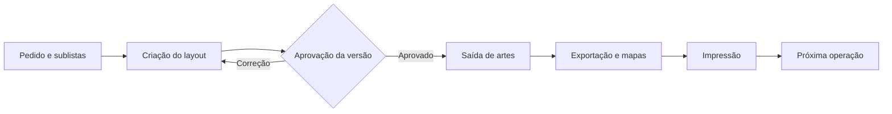
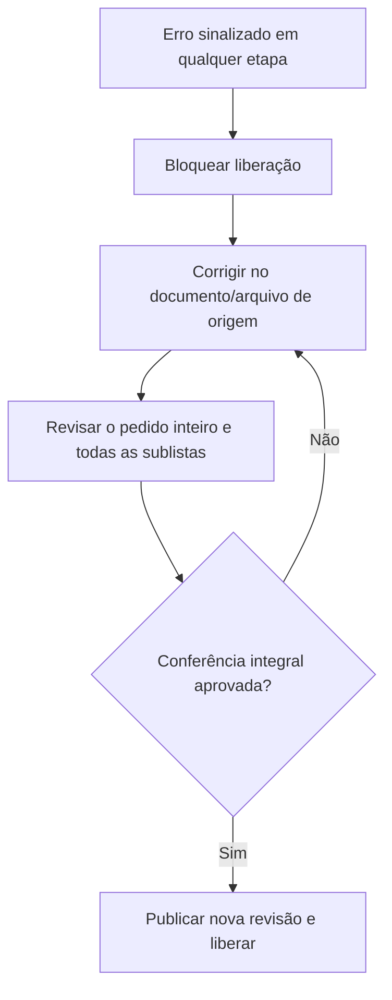

# MAN-DES-001 — Manual Geral do Setor de Arte

**Versão:** 0.4.0-draft (2026-11-16)  
**Situação:** em elaboração; ainda não homologado.  
**Abrangência:** do pedido à impressão. Integra todos os procedimentos do setor de arte sem confundir a responsabilidade técnica de cada etapa.

## 1. Como usar

Este documento é a **porta de entrada** da documentação. As regras detalhadas ficam nos procedimentos específicos e os controles por etapa nos checklists. A versão principal é composta por todos esses arquivos; **não se deve interpretar somente esta página como o manual completo**.

- [Pedido, layout e aprovação](01-PEDIDO-LAYOUT.md)
- [Saída de artes](02-SAIDA-DE-ARTES.md)
- [Modelagens e medidas](05-MODELAGENS-MEDIDAS.md)
- [Escudos, personalizações e SISBolt](07-ESCUDOS-SISBOLT.md)
- [Linhas, tecidos e gabaritos](06-LINHAS-GABARITOS.md)
- [Exportação e impressão](03-EXPORTACAO-IMPRESSAO.md)
- [Qualidade, erros e devoluções](04-QUALIDADE-ERROS.md)
- [Checklists integrados](../checklists/CHECKLISTS.md)
- [Gabaritos, fluxos e imagens pendentes](../referencias/IMAGENS-E-GABARITOS.md)
- [Pendências de validação](../governanca/PENDENCIAS.md)
- [Rastreabilidade dos requisitos](../governanca/RASTREABILIDADE.md)

## 2. Objetivo

Documentar como pedido, layout, aprovação, saída, exportação e impressão se relacionam, quais entregas são exigidas e quais verificações impedem retrabalho, material errado e uso de versões antigas.

**O conhecimento do processo inteiro não significa que o funcionário seja responsável por todos os controles.** Quem faz saída conhece que há tecidos distintos; quem exporta é responsável por conferir o tecido e o consumo de viés.

## 3. Fluxo geral

### Regra transversal de devolução

Os fluxogramas PDF já produzidos para os seis setores estão catalogados, mas ainda não foram enviados como anexos binários ao repositório público.

## 4. Matriz de papéis e entregas

| Etapa | Conferência principal | O que deve entregar |
|---|---|---|
| Entrada | Pedido, lista, sublistas, alterações e dúvidas | Pedido interpretado, sem ambiguidade crítica |
| Layout | Arte, patrocinadores, escudos, cores, variantes e legibilidade | Arquivo editável, completo, versionado |
| Revisão/aprovação | Pedido × layout × sublistas × versão | Aprovação rastreável |
| Saída | Modelo, recortes, grid, personalizações, escudos, SISBolt | Peças efetivas conferidas |
| Exportação | Gabaritos, tecidos, viés, componentes, mapas e arquivos | Mapa correto por material/rolo |
| Impressão | Pedido, mapa, versão, tecido, máquina e execução | Impressão identificada e rastreada |

**Autoridade formal dos aprovadores:** pendente de homologação; não presumir que a pessoa que prepara também pode aprovar.

## 5. Hierarquia da informação

1. Decisão específica e atual registrada no **pedido aprovado**.
2. Regra operacional homologada para a linha/peça.
3. Procedimento e checklist atualizados.
4. Gabarito vigente e arquivos de referência autorizados.
5. Arquivo de Atalhos ou exemplo histórico **somente como referência**.

Quando fontes divergirem, **não escolher livremente uma delas**. Interromper a etapa afetada e consultar vendedor/líder conforme a natureza da dúvida.

## 6. Regras críticas de qualidade

- Toda ocorrência sinalizada exige **correção e revisão do pedido inteiro**.
- É obrigatório confrontar o arquivo final **real**, não somente a prévia.
- Confirmar todos os patrocinadores/escudos individualmente, inclusive versões por cor e peças diferentes.
- Um dado na lista não impõe uma aplicação se o layout não apresentar a informação; esclarecer.
- O arquivo de Atalhos **não** substitui o pedido nem autoriza copiar marcas, números ou objetos ocultos.
- Na Saída: selecionar modelagem correta, aplicar exceções e revisar as peças pós-SISBolt.
- Na Exportação: conferir tecidos, rendimento/medidas de viés, gabaritos e mapa.
- Na Impressão: garantir arquivo, tecido, rolo e máquina correspondentes à ordem.

## 7. Regras de modelagem e aplicação — resumo

| Situação | Orientação |
|---|---|
| Short comum | Molde partido |
| Short com arte central | Molde inteiro |
| Short feminino de viés | Exceção; caso com arte central pendente |
| Bermuda comum | Molde partido e bolsos laterais |
| Bermuda com arte central | Consultar líder |
| Bermuda de juiz | Três bolsos; posição do terceiro a validar |
| Capuz de pesca | Sem forro, salvo pedido contrário |
| Outros capuzes | Com forro, salvo pedido contrário |
| Punho com escrita | Punho maior |
| Linha Especial | Sem etiqueta sublimada |
| Elementos na barra da blusa | Mínimo 8 cm da base, com marco de medição a confirmar |

Outras medidas, configurações de escudo e procedimentos completos estão nos capítulos específicos.

## 8. Identificação de imagens e gabaritos

O manual **não usará** como ilustrações finais os desenhos manuscritos ou os esquemas genéricos já rejeitados. Para exemplos que ainda não existem em versão aprovada, consultar o [catálogo com códigos e conteúdo esperado](../referencias/IMAGENS-E-GABARITOS.md). O PDF de gabaritos tem **dez páginas**; suas legendas foram catalogadas.

## 9. Evidências e checklists

Aplicar somente verificações pertinentes à peça/linha/etapa. O checklist digital planejado pode usar estados **Conferido / Pendente / Não se aplica**. A evidência deve representar o arquivo correto, com pedido, sublista e revisão identificáveis. Quando um arquivo muda após erro, revalidar as evidências afetadas e reconferir o pedido integralmente.

## 10. Critérios de homologação

Este material está em versão de trabalho. Só poderá ser tratado como procedimento oficial após:

- confirmação dos pontos técnicos listados em [Pendências](../governanca/PENDENCIAS.md);
- auditoria integral dos arquivos de origem e históricos relevantes, respeitando privacidade;
- revisão dos checklists detalhados e verificação de que nenhuma exigência foi descartada;
- conferência e aprovação das imagens/gabaritos;
- validação formal por quem responde pelo setor.

## 11. Controle de revisões

| Versão | Data | Situação |
|---|---|---|
| 0.3.0-draft | 2026-11-16 | Estrutura inicial em Markdown |
| **0.4.0-draft** | **2026-11-16** | Capítulos técnicos ampliados, documentação integrada e rastreabilidade inicial |

## 12. Complementação por fontes (edição 0.5)

As seguintes áreas passaram a ter procedimentos com referência explícita à reunião ou ocorrência que motivou o controle:

- [Interface entre Vendas, Layout e Saída](08-INTERFACE-VENDAS-LAYOUT.md): várias listas/layouts, múltiplos escudos, detalhes de gola, aplicações por categoria e teste de cor.
- [Qualidade de Layout para Saída](09-CONTROLE-QUALIDADE-LAYOUT.md): originais, vetor/bitmap, excedente, fontes e elementos próximos aos recortes.
- [Devoluções de Exportação e Impressão](10-DEVOLUCOES-EXPORTACAO-IMPRESSAO.md): conferência de mapa/tecido/arquivo, registro da falha e revisão integral.
- [Auditoria das fontes](../governanca/AUDITORIA-FONTES-V0.5.md): origens, exceções e lacunas.

**Atenção:** fontes históricas não conferem autoridade universal a uma exceção. A especificação da linha e a decisão registrada para o pedido vigente continuam sendo indispensáveis.

## 13. Conferência de estado do pedido — edição 0.6

As fontes históricas apontam pedidos cancelados ainda visíveis, pedidos direcionados a setores incorretos e divergência entre previsão impressa e a registrada no sistema. Por isso, a checagem de **status ativo, versão liberada e setor** precisa ocorrer em todas as transferências de trabalho.

Consulte [POP-DES-011 — Estado do pedido e revisões](11-CONTROLE-STATUS-VERSOES-PEDIDOS.md) e [AUD-006 — Revisão complementar de manuscritos](../governanca/AUDITORIA-MANUSCRITOS-V0.6.md).

O procedimento é uma **barreira preventiva proposta**, não prova que o software existente já forneça controle automático de status ou de revisão.

## 14. Checklist integral e reconciliação — edição 0.7

O checklist integrado `CHK-DES-GERAL-001 v0.2` contém **141 verificações**. A análise direta do checklist de Saída `CHK-DES-001 v1.4` confirmou a manutenção, com mesmo código e texto, de seus **98 itens**. A referência anterior a 140 itens era imprecisa.

- [Checklist integral em três partes](../checklists/CHECKLISTS.md#k-checklist-integral-preservado-por-códigos--edição-07)
- [Auditoria detalhada 0.7](../governanca/AUDITORIA-CHECKLIST-141-V0.7.md)

**Limite da conclusão:** preservação entre os dois DOCX citados não significa cobertura integral de todos os históricos, fotos e procedimentos ainda em auditoria. As verificações marcadas `V` exigem validação técnica.

## 15. Integridade dos grids e camadas (edição 0.8)

A auditoria do `Notes 2.pdf` encontrou ocorrências de **componentes em camadas erradas**, **mangas raglan curtas/longas confundidas** e **dianteiro de gola duplicado**. Antes e depois do SISBolt, a Saída deve conferir tipo, nome e camada de todas as peças e suas variantes.

Consulte [POP-DES-012 — Camadas, grids e moldes](12-CAMADAS-GRIDS-MOLDES.md) e [AUD-008 — Notes 2](../governanca/AUDITORIA-NOTES2-V0.8.md). Referências históricas de dimensões, nomes de objetos e disponibilidade de tamanhos não devem ser promovidas a padrões atuais sem validação.

## 16. Qualidade visual e integridade dos históricos (edição 0.9)

A auditoria dos históricos identificou defeitos registrados **após imprimir**: emenda de manga aparente, contorno fino desaparecendo, texto pequeno de patrocinador não reproduzido e tonalidade de fundo divergente. São riscos que exigem conferência em mais de um setor; a etapa em que o erro aparece não determina automaticamente a causa.

Consulte [POP-DES-013 — Qualidade pré-impressão](13-QUALIDADE-VISUAL-PRE-IMPRESSAO.md) e [AUD-009 — Auditoria de fontes](../governanca/AUDITORIA-FONTES-V0.9.md).

Os ZIPs de conversa publicados no GitHub são **exportações compactas** e não representam a totalidade das versões históricas previamente fornecidas. O manual não deve ser declarado completamente auditado enquanto as versões maiores não forem reconciliadas.
